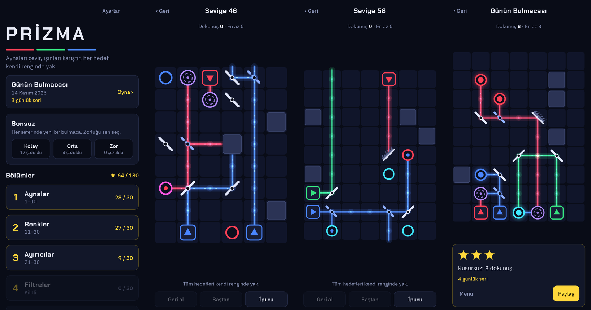

# Prizma

Renkli ışınları aynalarla yönlendirip her hedefi kendi renginde yaktığın bir Android bulmaca oyunu.
Kotlin ve Jetpack Compose ile yazıldı; internet ve izin gerektirmez.

**[APK'yı indir](https://github.com/talha24052050/prizma/releases/latest)** · Android 7.0 ve üzeri



## Oyun

- **Aynaya dokun**, döner ve ışının yolunu değiştirir.
- **Hedef (halka)** yalnızca tam kendi rengindeki ışıkla yanar. Ortadaki nokta, o an hedefe ulaşan rengi gösterir.
- **Renkler hedefte karışır:** kırmızı + yeşil = sarı, kırmızı + mavi = mor, yeşil + mavi = camgöbeği, üçü = beyaz.
- Ne kadar az dokunuşla çözersen o kadar yıldız: "En az" sayısına ulaşırsan üç yıldız.

Altı bölüm, her biri on seviye ve yeni bir parça:

| Bölüm | Parça | Ne yapar |
| --- | --- | --- |
| 1 Aynalar | Ayna | Işını 90° çevirir |
| 2 Renkler | Birden çok kaynak | Renkler hedefte karışır |
| 3 Ayırıcılar | Ayırıcı | Işını hem geçirir hem yansıtır |
| 4 Filtreler | Renkli cam, beyaz ışık | Yalnızca kendi rengini geçirir |
| 5 Kapılar | Işınlanma kapısı | Giren ışın eşinden aynı yöne çıkar |
| 6 Tek Yüzlü Aynalar | Tek yüzlü ayna | Parlak yüzü yansıtır, sırtı durdurur; dört yöne döner |

Ayrıca:

- **Günün Bulmacası:** her gün herkese aynı bulmaca, üst üste çözülen gün serisi ve sonucu paylaşma.
- **Sonsuz:** kolay, orta ya da zor; bitmeyen bulmaca dizisi.
- **Tanıtım kartları:** yeni bir parça ilk çıktığında, nasıl çalıştığını gösteren hareketli küçük bir örnek.
- **Renk harfleri:** renkleri ayırt etmekte zorlananlar için kaynak, filtre ve hedeflerde harf (Ayarlar'dan açılır).
- **Diller:** Türkçe ve İngilizce; telefonun dilini izler.
- Geri al, baştan başla, ipucu (bir dokunuşa mal olur), ses ve titreşim ayarı.

## Seviyeler nasıl üretiliyor

Seviyeler elle çizilmez; her biri numarasından türetilen bir tohumla üretilir ve her cihazda aynı çıkar.
Üretici (`core/.../Generator.kt`):

1. Parçaları rastgele yerleştirir; bu yerleşim çözümdür. Hedefleri ışınların geçtiği karelere koyar.
2. Çözümün ihtiyaç duymadığı her parçayı kaldırır: tahtada boşta parça kalmaz.
3. Hiçbir hamleye bağlı olmayan ışıkla beslenen hedefi reddeder: her hedefin ışığı en az bir oynar parçadan geçer.
4. Tüm parça durumlarını deneyerek çözümleri bulur, sonra tahtayı karıştırır. Başlangıçta hiçbir hedef
   yanmaz ve "her parçaya bir kez dokun" çözüm olmaz. "En az" sayısı, gereken en az dokunuştur.

Bu kuralların her biri 60 seviye, 30 günlük bulmaca ve 36 sonsuz bulmaca üzerinde testlerle doğrulanır.

## Derleme

JDK 17+ ve Android SDK (platform 35) gerekir.

```
./gradlew :core:test                 # oyun mantığı testleri (Android gerekmez)
./gradlew :app:testDebugUnitTest     # uygulama testleri; ekran görüntülerini app/build/shots/ altına yazar
./gradlew :app:assembleRelease       # app/build/outputs/apk/release/app-release.apk
```

GitHub Actions her push'ta testleri çalıştırır, APK'ları ve ekran görüntülerini çalışmanın "Artifacts"
bölümüne ekler. `v1.0` gibi bir etiket gönderildiğinde APK ayrıca "Releases" sayfasında yayımlanır:

```
git tag v1.0 && git push origin v1.0
```

Uygulama testleri bir cihaz gerektirmez: Robolectric üzerinde gerçek ekranları çizer ve bir oyuncu gibi
dokunarak ana ekrandan seviye sonuna kadar oynar (`AppFlowTest`).

### İmza

Depodaki `app/debug.keystore` herkese açık bir hata ayıklama anahtarıdır; amacı, farklı makinelerde derlenen
APK'ların birbirinin üzerine kurulabilmesidir. Hiçbir şeyi korumaz. Play Store'a yüklemek için kendi
anahtarını oluşturup `app/build.gradle.kts` içindeki `release` imza ayarını onunla değiştirmen gerekir:

```
keytool -genkeypair -v -keystore prizma-release.jks -alias prizma -keyalg RSA -keysize 2048 -validity 10000
```

Bu dosyayı ve parolasını depoya koyma; kaybedersen uygulamayı güncelleyemezsin.

## Yapı

| Yol | İçerik |
| --- | --- |
| `core/` | Saf Kotlin: tahta modeli, ışın izleme, çözücü, seviye üretici ve testleri |
| `app/src/main/kotlin/.../Board.kt` | Tahtanın çizimi (Compose Canvas) |
| `app/src/main/kotlin/.../Session.kt` | Bir oyunun durumu: hamleler, geri alma, ipucu |
| `app/src/main/kotlin/.../Store.kt` | İlerleme ve ayarların saklanması |
| `app/src/main/kotlin/.../Home.kt`, `Game.kt`, `Settings.kt`, `Intro.kt` | Ekranlar ve tanıtım kartları |
| `app/src/main/kotlin/.../Sfx.kt` | Kod içinde üretilen ses efektleri (ses dosyası yok) |

## Lisanslar

Yazı tipleri Chakra Petch ve IBM Plex Sans, SIL Open Font License 1.1 ile dağıtılır; metinler `licenses/` altında.
